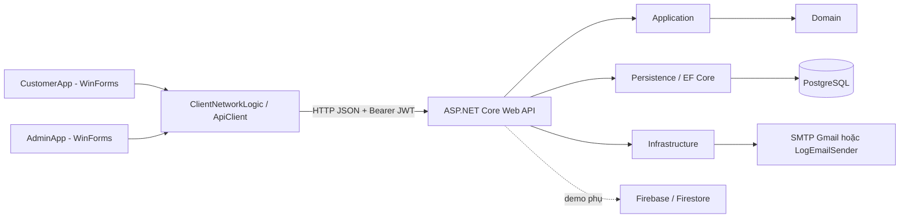
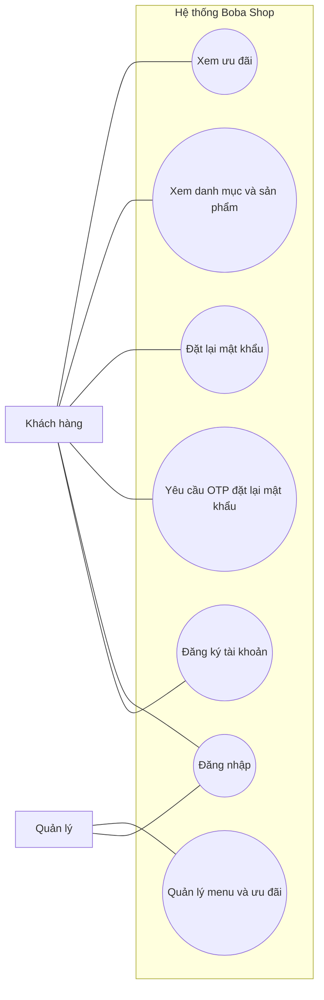
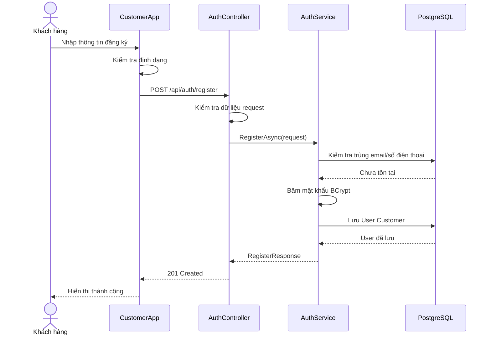
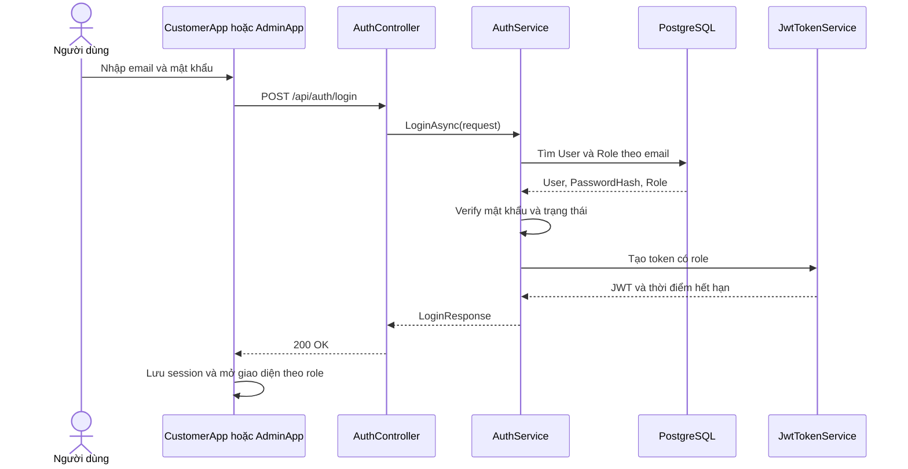
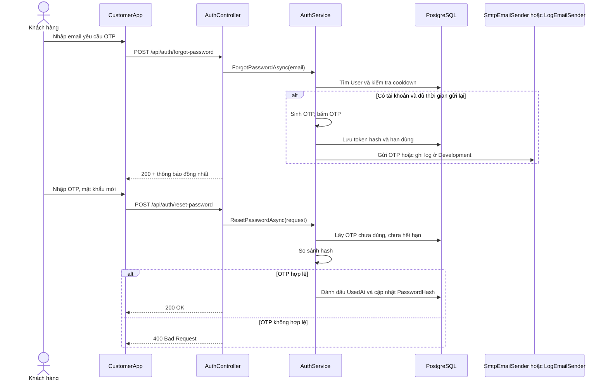
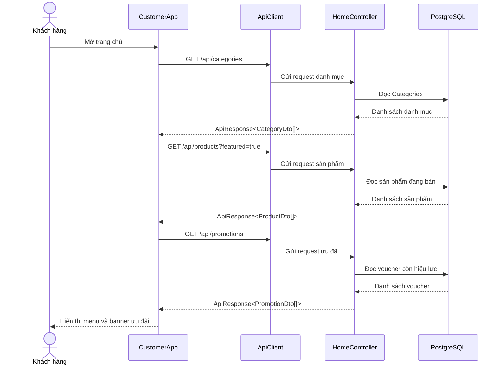

# CHƯƠNG 2. PHÂN TÍCH VÀ THIẾT KẾ HỆ THỐNG

> Bản thảo kỹ thuật để ghép vào báo cáo giữa kỳ. Cập nhật ảnh giao diện và thông tin nhóm sau khi các phần CustomerApp hoàn tất.

## 2.1. Tổng quan

Boba Shop là hệ thống hỗ trợ khách hàng xem thực đơn, tạo tài khoản, đăng nhập và đặt lại mật khẩu. Quản lý sử dụng luồng riêng để vận hành dữ liệu và tài khoản quản trị. Trong phạm vi giữa kỳ, hệ thống tập trung vào xác thực người dùng, dữ liệu trang chủ và nền tảng kết nối Web API. PostgreSQL lưu dữ liệu nghiệp vụ; Firebase chỉ giữ endpoint demo theo yêu cầu bài tập.

## 2.2. Kiến trúc hệ thống

Hệ thống tổ chức theo Clean Architecture gồm Domain, Application, Infrastructure và Presentation. Domain chứa entity và enum; Application định nghĩa DTO, kiểm tra dữ liệu và interface; Infrastructure cài đặt truy cập PostgreSQL, băm mật khẩu, JWT và gửi email; Web API nhận request HTTP và trả JSON thống nhất. CustomerApp và AdminApp là WinForms client, gửi yêu cầu qua Web API.

PostgreSQL là nguồn dữ liệu chính cho người dùng và menu. Firebase được khởi tạo riêng khi có tệp `serviceAccountKey.json`; thiếu tệp thì endpoint demo báo dịch vụ chưa khả dụng, không cản trở luồng nghiệp vụ chính.

## 2.3. Tác nhân và ca sử dụng

Hai tác nhân chính là **Khách hàng** và **Quản lý**. Khách hàng đăng ký, đăng nhập, yêu cầu OTP, đặt lại mật khẩu và xem dữ liệu trang chủ. Quản lý đăng nhập bằng role Admin và vận hành dữ liệu quản trị. Việc giới hạn API quản trị được thực hiện ở phía Web API theo role trong JWT.

### UC-01 — Đăng ký tài khoản

- **Tác nhân:** Khách hàng chưa có tài khoản.
- **Tiền điều kiện:** Web API và PostgreSQL hoạt động.
- **Luồng chính:** Khách nhập họ tên, số điện thoại, email và mật khẩu; client kiểm tra định dạng; gửi `POST /api/auth/register`; server kiểm tra email/số điện thoại trùng, băm mật khẩu và lưu tài khoản Customer; client thông báo thành công.
- **Ngoại lệ:** Dữ liệu không hợp lệ trả `400`; email hoặc số điện thoại trùng trả `409`; lỗi kết nối hiển thị thông báo để khách thử lại.
- **Hậu điều kiện:** Tài khoản đã lưu, chưa tạo phiên đăng nhập.

### UC-02 — Đăng nhập

- **Tác nhân:** Khách hàng hoặc quản lý đã có tài khoản.
- **Luồng chính:** Người dùng nhập email và mật khẩu; client gửi `POST /api/auth/login`; server xác minh mật khẩu và trạng thái tài khoản, tạo JWT có claim role; client lưu token cùng thông tin người dùng và mở màn hình theo role.
- **Ngoại lệ:** Thông tin sai trả `401` với thông báo chung; tài khoản bị khóa không được cấp token.
- **Hậu điều kiện:** Phiên hợp lệ được lưu ở client; API yêu cầu xác thực nhận header `Authorization: Bearer <accessToken>`.

### UC-03 và UC-04 — Yêu cầu OTP và đặt lại mật khẩu

- **Tác nhân:** Khách hàng chưa đăng nhập.
- **Luồng chính:** Khách gửi email đến `POST /api/auth/forgot-password`; hệ thống trả cùng một thông báo bất kể email có tồn tại. Nếu có tài khoản, server tạo OTP sáu chữ số, lưu hash, giới hạn gửi lại 60 giây và gửi email. Khách nhập OTP cùng mật khẩu mới tại `POST /api/auth/reset-password`; server kiểm tra hash, hạn 10 phút và trạng thái chưa dùng, sau đó thay password hash và đánh dấu OTP đã dùng.
- **Ngoại lệ:** OTP sai, hết hạn hoặc đã dùng trả lỗi tổng quát; email không hợp lệ bị từ chối kiểm tra dữ liệu.
- **Hậu điều kiện:** Mật khẩu mới có hiệu lực; OTP không thể dùng lần thứ hai.

### UC-05 và UC-06 — Xem trang chủ

- **Tác nhân:** Khách hàng.
- **Luồng chính:** Client gọi `GET /api/categories`, `GET /api/products?featured=true` và `GET /api/promotions`; server chỉ trả sản phẩm đang bán và voucher đang hoạt động, còn lượt dùng, chưa hết hạn; client hiển thị danh mục, món và banner ưu đãi.
- **Ngoại lệ:** Khi chưa có dữ liệu phù hợp, API trả mảng rỗng; khi mạng lỗi, client hiển thị trạng thái lỗi có thể thử lại.

## 2.4. Sơ đồ tuần tự

### Đăng ký

### Đăng nhập

### Quên mật khẩu và xác minh OTP

### Tải trang chủ

## 2.5. Thiết kế API và dữ liệu

API trả cấu trúc thống nhất `{ success, message, data }`. Auth API gồm đăng ký, đăng nhập, yêu cầu OTP và đặt lại mật khẩu. API trang chủ gồm danh mục, sản phẩm đang bán và ưu đãi lấy từ voucher còn hiệu lực. Thời gian truyền theo UTC ISO 8601; OTP được biểu diễn bằng chuỗi để không mất số 0 đầu.

Entity `PasswordResetToken` liên kết với User, chỉ lưu `TokenHash`, `ExpiresAt`, `UsedAt` và `CreatedAt`. PostgreSQL dùng unique email và phone để bảo vệ tính duy nhất; việc xác nhận trùng ở service giúp trả lỗi nghiệp vụ phù hợp.

## 2.6. Bảo mật và cấu hình

Mật khẩu được lưu dưới dạng BCrypt hash. OTP được lưu dưới dạng SHA-256 hash, có hạn dùng và sử dụng một lần. JWT ký bằng khóa bí mật cấu hình qua User Secrets; role được đưa vào token để Web API phân quyền. Gmail SMTP chỉ nhận thông tin đăng nhập từ User Secrets. Ở Development, `LogEmailSender` là phương án demo; log OTP chỉ dùng trong môi trường này.

## 2.7. Phạm vi và giới hạn bản giữa kỳ

ERD hiện chưa có cờ “nổi bật”, do đó `featured=true` trả sản phẩm đang bán theo thứ tự mã sản phẩm. Banner ưu đãi tối thiểu được dựng từ voucher còn hiệu lực. Việc quản trị menu đầy đủ, thanh toán, đặt món và cập nhật real-time thuộc các giai đoạn tiếp theo của đồ án.
