# CHƯƠNG 3. THIẾT KẾ VÀ CÀI ĐẶT GIAO DIỆN

> Bản thảo kỹ thuật để ghép vào báo cáo giữa kỳ. Ảnh màn hình CustomerApp nằm trong `docs/images/`.

## 3.1. Tổng quan

CustomerApp là ứng dụng WinForms dành cho khách hàng. Trong phạm vi giữa kỳ, ứng dụng gồm ba màn xác thực (đăng nhập, đăng ký, quên mật khẩu) và khung chính với hai trang (Trang chủ, Thực đơn), kèm cửa sổ hồ sơ khách hàng.

Giao diện tuân theo ba nguyên tắc:

- **Tách giao diện khỏi việc gọi mạng.** Form chỉ gọi các interface trong `Services/` (`IAuthService`, `IMenuService`, `IPromotionService`, `IProfileService`). Form không dùng `HttpClient` và không biết dữ liệu đến từ đâu.
- **Dùng chung một hệ thống giao diện.** Màu, font và khoảng cách lấy từ `ClientNetworkLogic/Theme`, form không tự đặt màu hay font riêng. Các control dùng lại nhiều nơi nằm trong `ClientNetworkLogic/Controls` để AdminApp cũng dùng được.
- **Dựng giao diện bằng code.** Các màn mới không có file Designer. Kích thước viết theo pixel ở tỉ lệ 100% rồi nhân với tỉ lệ hiển thị của màn hình (hàm `UiScale.Px`), nhờ đó bố cục không vỡ khi Windows đặt tỉ lệ 125% hoặc 150%.

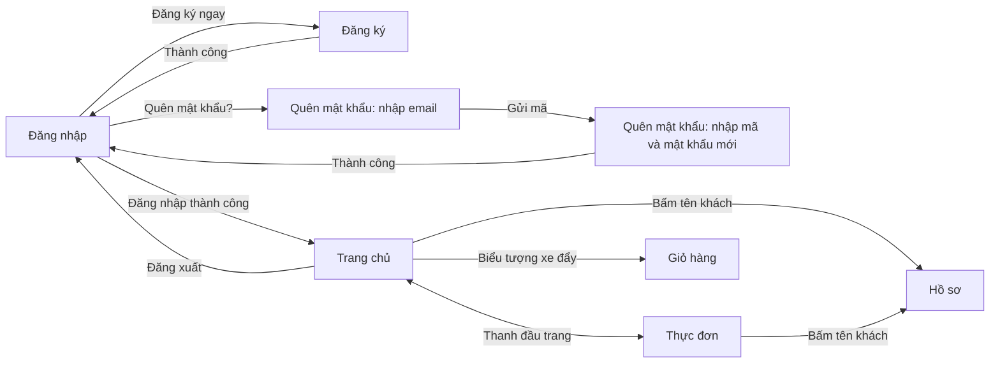

## 3.2. Hệ thống giao diện chung

### Màu sắc (`AppColors`)

| Tên | Giá trị RGB | Dùng cho |
|---|---|---|
| `Primary` | 38, 99, 59 | Nút chính, liên kết, thẻ khuyến mãi, chân trang |
| `PrimaryDark` | 27, 74, 43 | Trạng thái rê chuột và nhấn của nút, liên kết |
| `BrandDark` | 18, 46, 24 | Nền và lớp phủ của mảng ảnh thương hiệu |
| `Background` | 247, 244, 238 | Nền form |
| `Surface` | 255, 255, 255 | Nền ô nhập, thẻ món, thanh đầu trang |
| `TextPrimary` | 43, 33, 24 | Chữ chính |
| `TextSecondary` | 107, 93, 82 | Chữ mô tả, trạng thái |
| `Error` | 179, 40, 45 | Thông báo lỗi, viền ô nhập đang lỗi |
| `InputBorder` | 184, 172, 158 | Viền ô nhập ở trạng thái thường |
| `Divider` | 230, 222, 212 | Đường kẻ, viền thẻ |

Màu xanh `Primary` trùng với màu màn giỏ hàng đã có từ trước, để các màn cũ và mới đồng bộ.

### Kiểu chữ (`AppFonts`)

Tiêu đề, tên quán và chữ trên nút dùng font **Baloo 2**; nội dung, nhãn và ô nhập dùng **Be Vietnam Pro**. Cả hai đều hỗ trợ đầy đủ dấu tiếng Việt và phát hành theo giấy phép SIL Open Font License. Bốn file font (bản thường và bản đậm của mỗi font) được nhúng vào `BobaShop.ClientNetworkLogic.dll` và nạp lúc khởi động, nên máy chạy ứng dụng không cần cài font. Nếu nạp không được, ứng dụng tự dùng Segoe UI.

### Control dùng chung (`ClientNetworkLogic/Controls`)

| Control | Vai trò |
|---|---|
| `PrimaryButton` | Nút hành động chính, đổi màu khi rê chuột và khi bị vô hiệu hóa |
| `TextField` | Ô nhập một dòng cao 44 px, viền xanh khi đang nhập, viền đỏ khi lỗi |
| `SearchBox` | Ô tìm kiếm trên thanh đầu trang, kế thừa `TextField` |
| `ImageSlideshow` | Khung ảnh tự chuyển có hiệu ứng mờ dần và phóng to chậm, tùy chọn mũi tên và chấm chọn ảnh |

### Kiểm tra dữ liệu nhập (`Validator`)

Dữ liệu được kiểm tra ngay ở client để báo lỗi sớm; server vẫn kiểm tra lại. Quy tắc ở client khớp với `AuthValidation` phía server:

| Trường | Quy tắc |
|---|---|
| Họ và tên | Bắt buộc, tối đa 100 ký tự |
| Email | Bắt buộc, đúng định dạng, tối đa 150 ký tự |
| Số điện thoại | Bắt đầu bằng 0, tổng cộng 10 hoặc 11 chữ số |
| Mật khẩu mới | Ít nhất 8 ký tự, có chữ hoa, chữ thường, chữ số và ký tự đặc biệt |
| Nhập lại mật khẩu | Phải trùng với mật khẩu |
| Mã xác nhận | Đúng 6 chữ số |

Lỗi hiển thị bằng chữ đỏ ngay dưới ô nhập tương ứng, viền ô chuyển sang đỏ và con trỏ được đưa về ô lỗi đầu tiên. Khi người dùng sửa nội dung, lỗi của ô đó tự ẩn.

## 3.3. Các màn xác thực

Ba màn dùng chung lớp `AuthFormBase`: cửa sổ 1200 × 700 chia theo tỉ lệ 70/30. Bên trái là mảng thương hiệu (`AuthBrandPanel`) gồm ảnh tự chuyển, logo, tên quán và khẩu hiệu. Bên phải là cột form rộng 296 px, các thành phần xếp từ trên xuống và tự căn giữa theo chiều dọc.

### Đăng nhập (`LoginForm`)

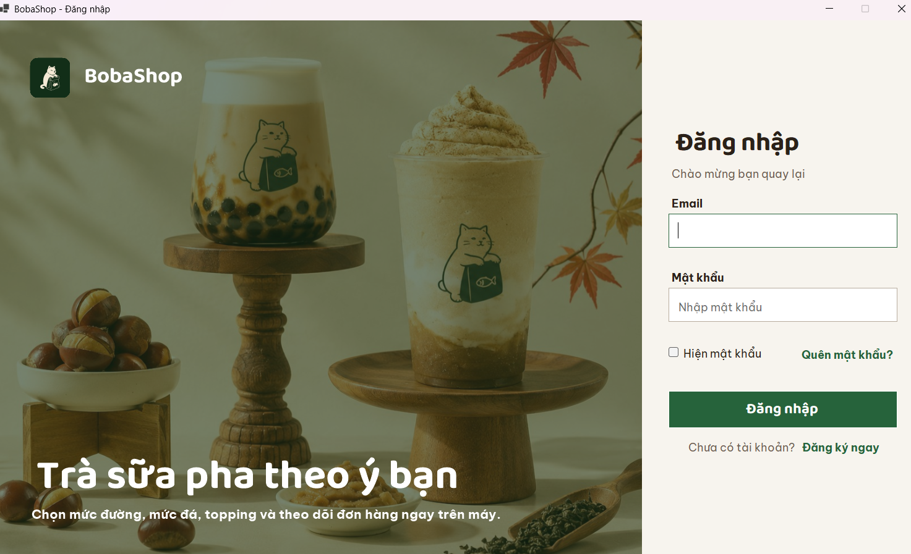

- Ô nhập email và mật khẩu, ô chọn "Hiện mật khẩu", liên kết "Quên mật khẩu?" và "Đăng ký ngay".
- Trong lúc chờ server, nút đổi thành "Đang đăng nhập..." và các ô nhập bị khóa để tránh bấm nhiều lần.
- Sai thông tin thì hiển thị thông báo chung do server trả về, không cho biết email hay mật khẩu sai.
- Đăng nhập thành công thì mở khung chính.

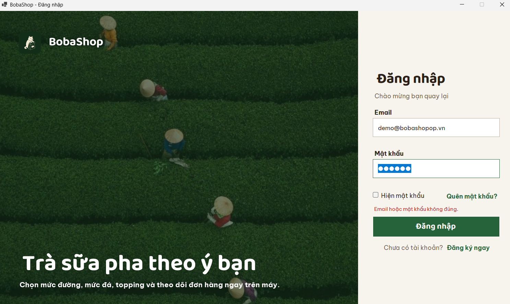

### Đăng ký (`RegisterForm`)

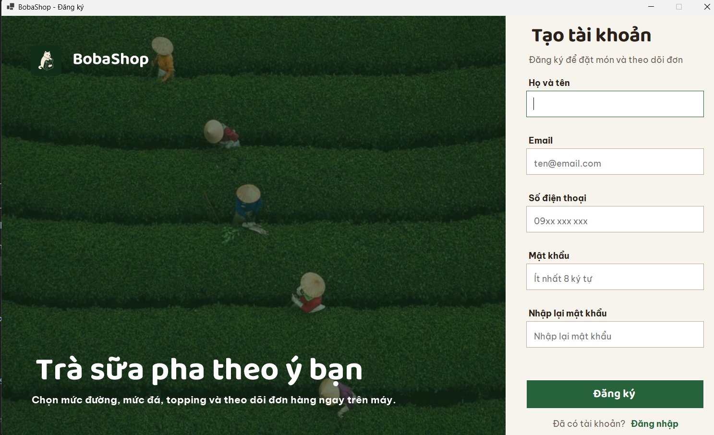

- Năm ô nhập: họ và tên, email, số điện thoại, mật khẩu, nhập lại mật khẩu.
- Đăng ký thành công thì thông báo, quay về màn đăng nhập và điền sẵn email vừa đăng ký. Đăng ký không tự tạo phiên đăng nhập, đúng theo hợp đồng API.
- Email hoặc số điện thoại đã dùng thì hiển thị thông báo của server (mã `409`).

### Quên mật khẩu (`ForgotPasswordForm`)

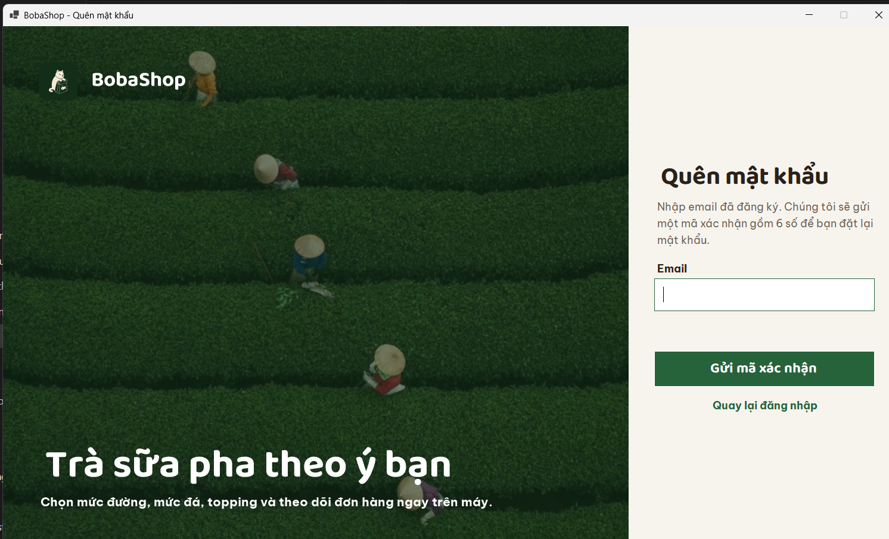

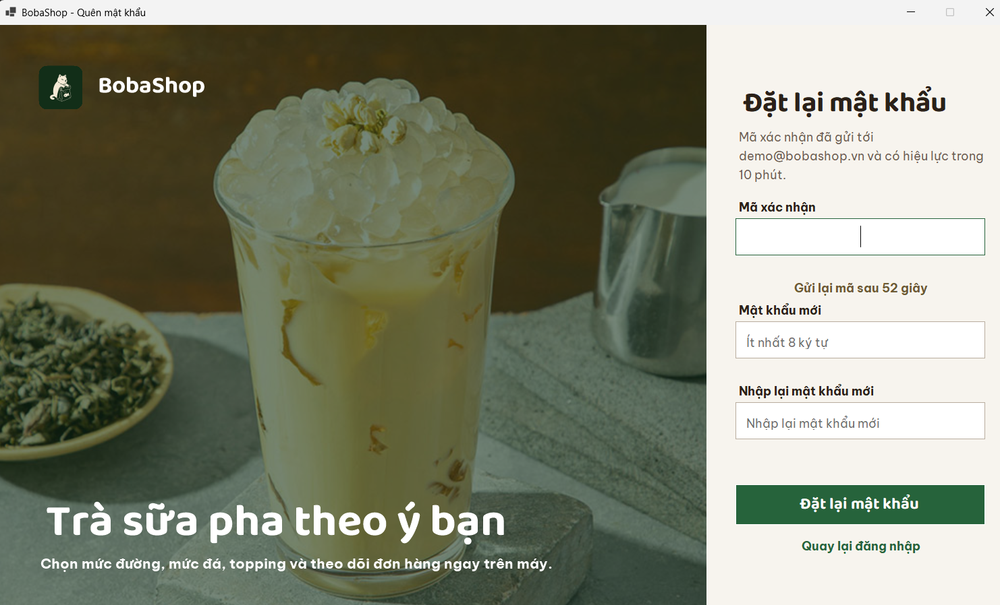

Hai bước nằm trong cùng một cửa sổ:

1. Nhập email đã đăng ký và bấm "Gửi mã xác nhận". Ứng dụng luôn chuyển sang bước hai dù email có tồn tại hay không, vì server trả cùng một phản hồi để không lộ email nào đã có tài khoản.
2. Nhập mã 6 chữ số, mật khẩu mới và nhập lại. Liên kết "Gửi lại mã" bị khóa và đếm ngược 60 giây, khớp giới hạn gửi lại phía server. Mã có hiệu lực 10 phút.

Đặt lại thành công thì quay về màn đăng nhập với email điền sẵn.

## 3.4. Khung chính và Trang chủ

### Khung chính (`CustomerMainForm`)

Khung chính gồm thanh đầu trang cố định và vùng nội dung hiển thị một trang tại một thời điểm. Cửa sổ kéo to nhỏ được, kích thước tối thiểu 1080 × 600.

Thanh đầu trang, từ trái sang phải:

- Logo và tên quán.
- Hai mục điều hướng **Trang chủ** và **Thực đơn**. Mục ứng với trang đang mở có vạch xanh bên dưới.
- Ô tìm kiếm. Gõ từ khóa ở bất kỳ trang nào thì ứng dụng chuyển sang Thực đơn và lọc ngay.
- Biểu tượng giỏ hàng (`CartButton`), mở màn giỏ hàng. Huy hiệu số món chỉ hiện khi giỏ có hàng.
- Ô tài khoản (`UserChip`): hình tròn mang chữ cái đầu của tên và tên khách, bấm vào để mở hồ sơ.
- Liên kết **Đăng xuất**, đưa người dùng về màn đăng nhập.

### Trang chủ (`HomePage`)

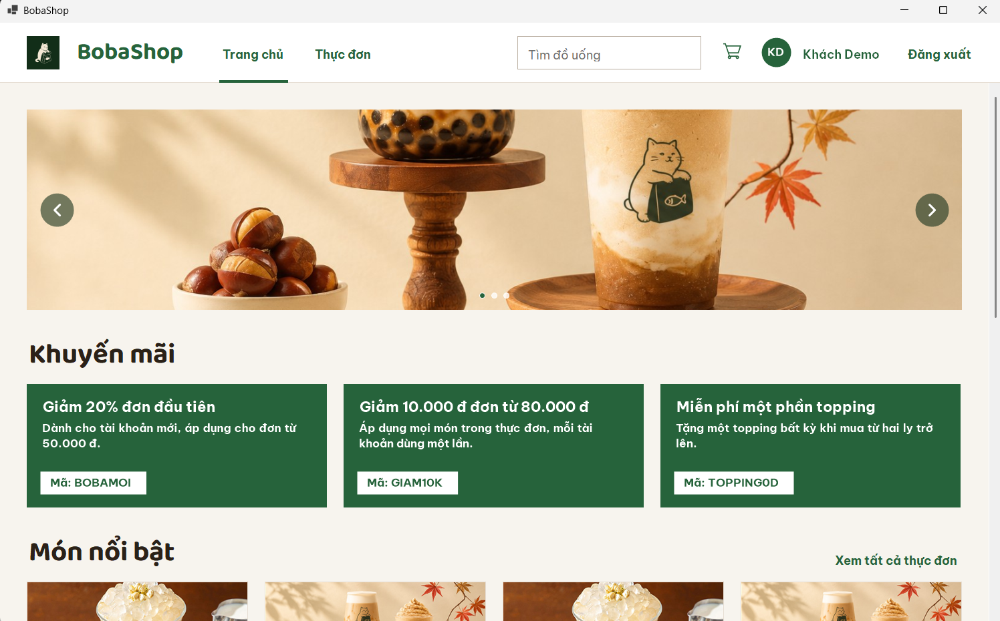

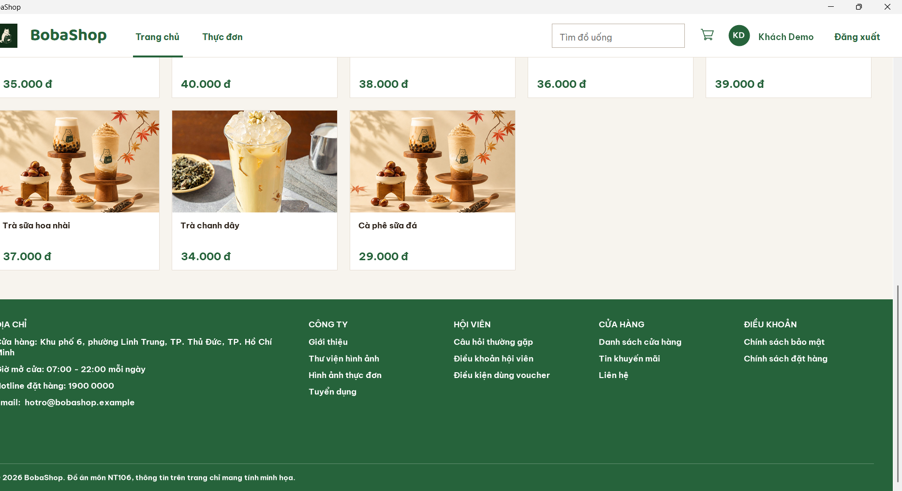

Trang chủ cuộn dọc, gồm bốn khu vực:

1. **Banner ảnh.** Ba ảnh tự chuyển sau mỗi 6 giây. Người dùng có thể bấm mũi tên trái/phải hoặc các chấm bên dưới để tự chọn ảnh.
2. **Khuyến mãi.** Mỗi khuyến mãi là một thẻ (`PromotionCard`) gồm tiêu đề, mô tả và mã áp dụng. Dữ liệu lấy từ `GET /api/promotions`.
3. **Món nổi bật.** Lưới thẻ món (`ProductGrid`, `ProductCard`), mỗi thẻ gồm ảnh, tên và giá định dạng theo VND. Trang chủ hiển thị tối đa 8 món đầu của `GET /api/products?featured=true`, kèm liên kết "Xem tất cả thực đơn".
4. **Chân trang** (`PageFooter`). Thông tin liên hệ và các nhóm mục xếp thành cột. Nội dung chân trang là thông tin minh họa cho đồ án.

Hai khu vực khuyến mãi và món nổi bật tải độc lập. Khu vực nào đang tải, trống hoặc lỗi thì hiển thị dòng trạng thái ngay tại khu vực đó, không ảnh hưởng khu vực còn lại.

Số cột của lưới món tự tính theo bề rộng cửa sổ, sao cho mỗi thẻ không hẹp hơn 240 px.

## 3.5. Trang Thực đơn (`MenuPage`)

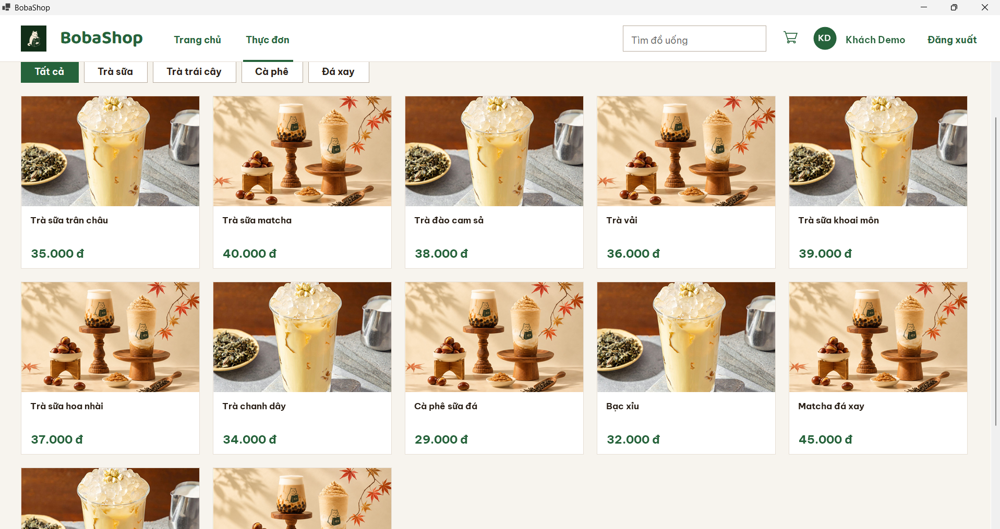

- Hiển thị toàn bộ món đang bán, lấy từ `GET /api/products`.
- Hàng nút lọc theo danh mục, gồm "Tất cả" và các danh mục từ `GET /api/categories`. Nút đang chọn tô xanh.
- Tìm kiếm theo tên món, không phân biệt hoa thường và không cần gõ dấu (gõ "tra sua" vẫn tìm ra "Trà sữa"). Lọc danh mục và tìm kiếm áp dụng đồng thời.
- Không có món nào khớp thì hiển thị "Không tìm thấy món phù hợp."

## 3.6. Hồ sơ khách hàng (`ProfileForm`)

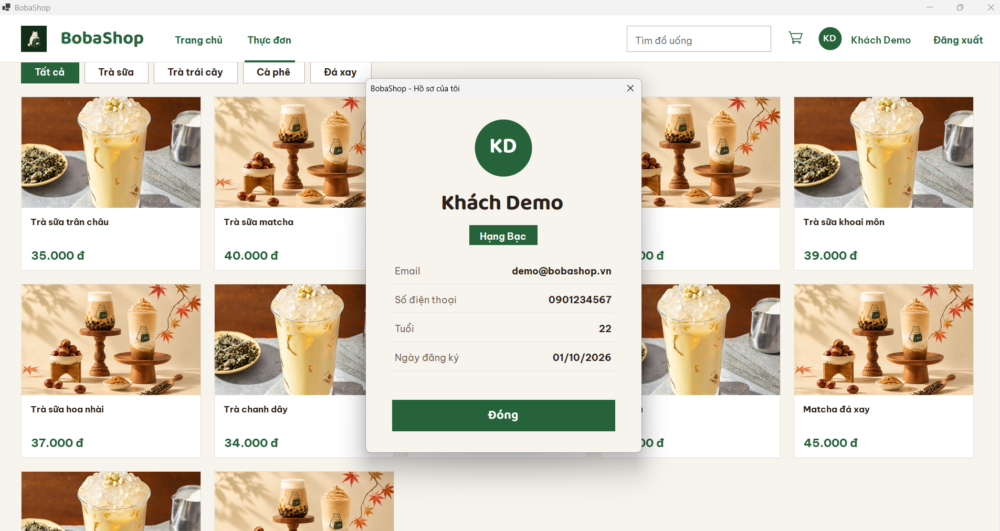

Cửa sổ hồ sơ hiển thị ảnh đại diện dạng chữ cái đầu, họ tên, hạng thành viên, email, số điện thoại, tuổi và ngày đăng ký. Trường nào chưa có dữ liệu thì hiển thị "Chưa cập nhật".

## 3.7. Kết nối với Web API

Mỗi interface service có hai bản cài đặt. Bản giả trả dữ liệu mẫu trong bộ nhớ, dùng để dựng và thử giao diện khi chưa có server. Bản thật gọi Web API qua `ApiClient` của `ClientNetworkLogic` và dùng DTO của `Application`. `Program.cs` chọn bản nào dựa trên tham số dòng lệnh:

```
dotnet run --project src/Presentation/Clients/BobaShop.CustomerApp
dotnet run --project src/Presentation/Clients/BobaShop.CustomerApp -- --api http://localhost:5227
```

Lệnh thứ nhất chạy bằng dữ liệu giả, lệnh thứ hai nối với Web API tại địa chỉ đã cho.

| Màn hình | Service | Endpoint |
|---|---|---|
| Đăng nhập | `AuthService.LoginAsync` | `POST /api/auth/login` |
| Đăng ký | `AuthService.RegisterAsync` | `POST /api/auth/register` |
| Quên mật khẩu, bước 1 | `AuthService.SendPasswordResetCodeAsync` | `POST /api/auth/forgot-password` |
| Quên mật khẩu, bước 2 | `AuthService.ResetPasswordAsync` | `POST /api/auth/reset-password` |
| Trang chủ, khuyến mãi | `PromotionService.GetActivePromotionsAsync` | `GET /api/promotions` |
| Trang chủ, món nổi bật | `MenuService.GetFeaturedProductsAsync` | `GET /api/products?featured=true` |
| Thực đơn | `MenuService.GetCategoriesAsync`, `GetProductsAsync` | `GET /api/categories`, `GET /api/products` |

Mọi lời gọi đều bất đồng bộ (`async`/`await`) nên giao diện không bị đứng trong lúc chờ. Khi không kết nối được server, `ApiClient` trả về thông báo tiếng Việt và form hiển thị thông báo đó cho người dùng.

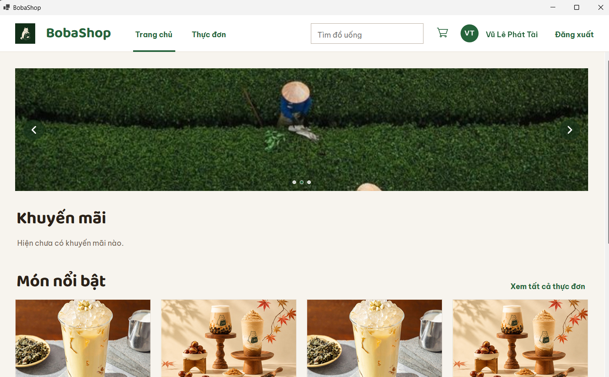

Hình 3.10 chụp khi ứng dụng nối với Web API và PostgreSQL chạy trên máy phát triển. Tên trên thanh đầu trang là tên tài khoản lưu trong cơ sở dữ liệu. Khu vực khuyến mãi hiển thị "Hiện chưa có khuyến mãi nào." vì lúc chụp bảng voucher chưa có dữ liệu.

## 3.8. Hạn chế và hướng phát triển

- **Ảnh món.** API hiện trả `imageUrl` rỗng, nên các thẻ món dùng luân phiên hai ảnh có sẵn. Khi có ảnh từng món, `ProductGrid` sẽ tải theo `imageUrl`.
- **Hồ sơ khách hàng.** Chưa có API hồ sơ. Khi nối server thật, hồ sơ chỉ có họ tên và email lấy từ phản hồi đăng nhập. Ngày sinh và hạng thành viên chưa có trong mô hình dữ liệu.
- **Phiên đăng nhập.** Token đang được giữ trong `AuthService` của client và mất khi tắt ứng dụng. Phần lưu phiên (`SessionManager`) sẽ thay thế cách này.
- **Giỏ hàng.** Biểu tượng giỏ hàng mở màn giỏ hàng có sẵn, nhưng chưa có chức năng thêm món từ thẻ món, nên số món trên huy hiệu luôn bằng 0.
- **Món nổi bật.** ERD chưa có cờ đánh dấu món nổi bật, nên trang chủ lấy 8 món đầu danh sách.
- **Điều hướng.** Các mục Đơn hàng, Voucher chưa có trên thanh đầu trang vì chưa có màn tương ứng.
